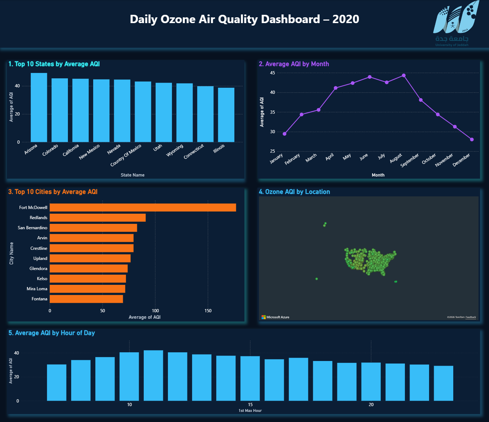

# Ozone Air Quality Analysis – Power BI

## Project Overview
This project analyzes ozone Air Quality Index (AQI) data across U.S. cities and states in 2020 using Microsoft Power BI.

The goal is to identify geographic and time-based air quality patterns through an interactive dashboard.

## Dashboard Preview

## Key Analyses

- **Top 10 States by Average AQI:** Compares average ozone AQI across states.
- **Average AQI by Month:** Examines monthly air quality trends.
- **Top 10 Cities by Average AQI:** Identifies cities with the highest average AQI.
- **Ozone AQI by Location:** Visualizes geographic patterns using Azure Maps.
- **Average AQI by Hour of Day:** Analyzes hourly variations in ozone AQI.

## Tools & Technologies

- Microsoft Power BI
- Data Visualization
- Azure Maps
- Exploratory Data Analysis (EDA)

## Project Highlights

- Designed an interactive dashboard with five analytical visualizations.
- Compared air quality measurements across different geographic locations.
- Explored monthly and hourly AQI patterns.
- Presented environmental data through charts and geographic mapping.

## Project Files

- [Ozone_Air_Quality_Analysis.pbix](Ozone_Air_Quality_Analysis.pbix) – Power BI project file.
- [dashboard.png](dashboard.png) – Dashboard screenshot.

## How to View the Project

1. Download the PBIX file.
2. Open it using Microsoft Power BI Desktop.
3. Explore the dashboard and its visualizations.

## Author

**Ali H. Alzahrani**  
Data Science Student | University of Jeddah
